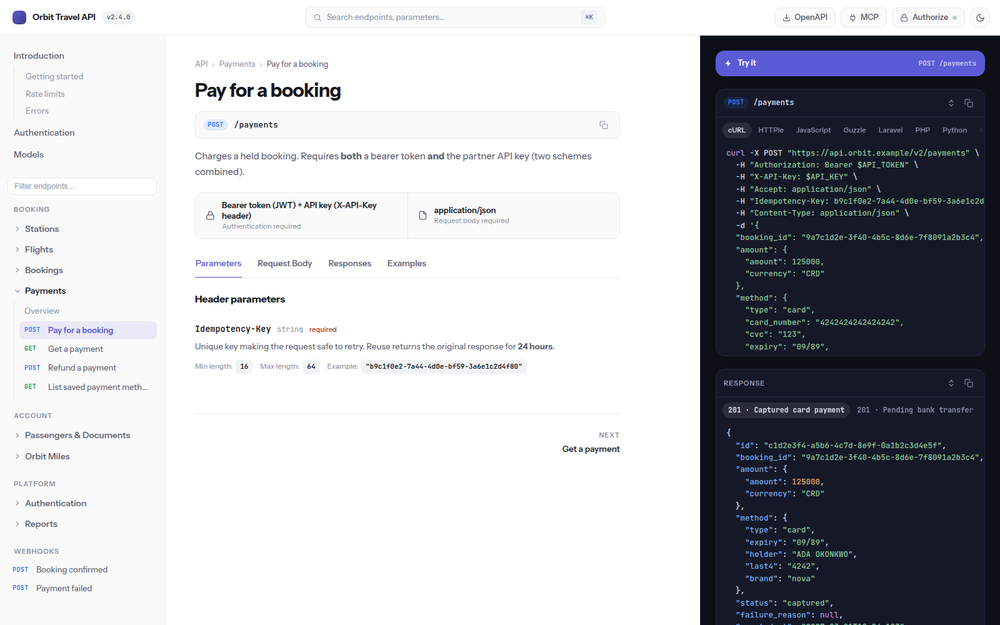
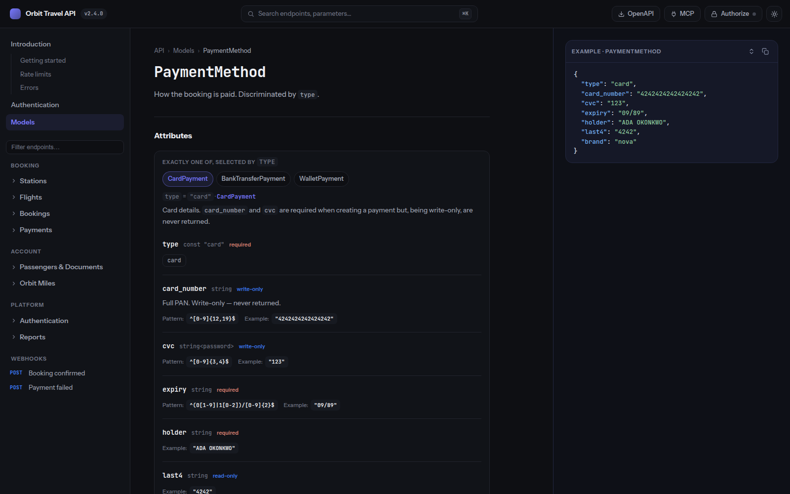
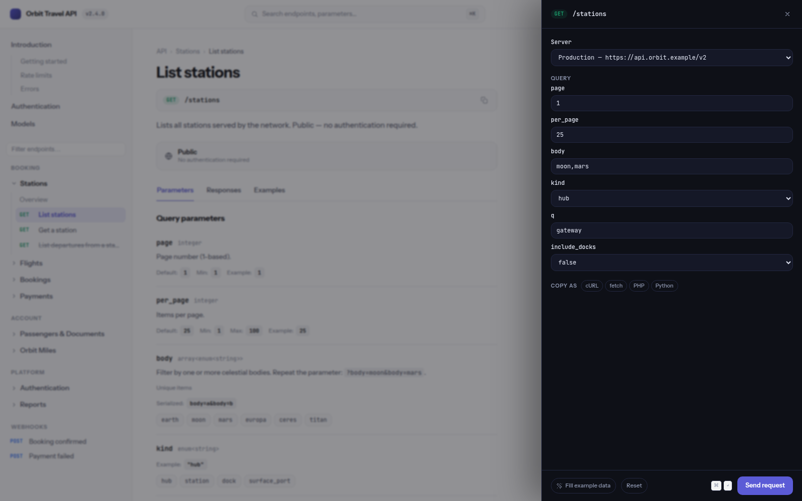

# Atlas

**Fast, static, three-column API documentation for OpenAPI 3.x and SOAP (WSDL)
— and a drop-in renderer for [Laravel Scramble](https://scramble.dedoc.co).**

Atlas turns an OpenAPI document into a fully static site: every endpoint,
model and tag is pre-rendered HTML, readable with JavaScript turned off.
JavaScript only adds search, the try-it console and conveniences. No framework,
no runtime OpenAPI parsing, no npm dependencies — Node alone builds it.



| | |
|---|---|
|  |  |

## Highlights

- **Reads like Stripe's docs.** Navigation, documentation and a dark code
  column side by side; nested attributes collapse; responses expanded.
- **Complete OpenAPI 3.0 and 3.1.** `oneOf`/`anyOf` as variant tabs with
  discriminator mapping, `allOf` merging, `additionalProperties` maps,
  `readOnly`/`writeOnly` hidden where they do not apply, nullable type
  unions, `const`, all constraints, multiple media types, named example
  switchers, response headers, cookie parameters, callbacks, webhooks,
  server variables, tag groups (`x-tagGroups`), `x-displayName`,
  `x-codeSamples`, deprecations.
- **SOAP services from WSDL** — next to your REST API or on their own:
  operations with full XML envelopes, SOAP 1.1/1.2, faults, XSD types as
  browsable models (abstract types, `choice`, attributes, imports across
  dozens of files), PHP `SoapClient` / zeep / cURL samples and try-it —
  with **WS-Security** from the WSDL's policy: UsernameToken (digest),
  Timestamp, and tokens fetched from an STS via WS-Trust.
- **YAML or JSON, one file or many** — external `$ref`s across files are
  bundled at build time.
- **Code samples in 12 clients** — cURL, HTTPie, JavaScript, Guzzle, Laravel
  `Http`, PHP, Python requests, HTTPX, Go, Ruby, Java, C# — with credentials
  derived from each operation's security requirements.
- **Try it** — a slide-over console with every security scheme (bearer,
  basic, API key in header/query/cookie, OAuth 2.0 client-credentials and
  password grants, OpenID Connect), server variables, JSON / form / multipart
  bodies, request history and a JSON tree viewer.
- **Search** (⌘K) — typo-tolerant, diacritic-folding, ranked across
  endpoints, parameters, schema fields, tags and models; fully offline.
- **MCP server** — the docs answer the Model Context Protocol, so Claude
  Code, Cursor or VS Code can search your API while writing code against it.
- **Machine-readable mirrors** — `/openapi.json`, `/llms.txt` and a markdown
  twin of every page.
- **Sensible without examples.** Specs generated from code rarely have them;
  Atlas fills bodies with plausible values guessed from property names.
- **Small.** ~6 KB of JavaScript (gzip) on page load; search and try-it load
  on first use. Light and dark, keyboard-first, works on phones.
- **Themeable.** Built-in color presets, logo, favicon, and every design
  token overridable with your own CSS.

## Laravel / Scramble

```bash
composer require pjadanowski/atlas
```

Then in `config/scramble.php`:

```php
'renderer' => 'atlas',
```

That's all for development: with `auto_build` (on by default in the `local`
environment) the docs at `/docs/api` rebuild themselves whenever your API
changes. For production, build on deploy:

```bash
php artisan atlas:build
```

Requires PHP 8.2+, Laravel 12 or 13, Scramble ^0.13 and a `node` binary
(20+) on the machine that builds the docs — nothing to `npm install`.

### How it fits into Scramble

Atlas registers itself as a Scramble renderer next to `elements` and
`scalar`. `atlas:build` asks Scramble's own generator for the specification,
writes the site to `storage/app/atlas` and points every URL at the path
Scramble serves its docs from. Scramble's UI route returns the entry page; the
package serves everything below it — behind the **same middleware** Scramble
is configured with, so private docs stay private. The output stays outside
`public/` for the same reason.

What Scramble's config controls:

| Key in `config/scramble.php` | Effect in Atlas |
| --- | --- |
| `renderer` | must be `'atlas'` |
| `ui.title` | title in the top bar (falls back to `app.name`) |
| `info.version`, `info.description` | version badge, home page introduction (markdown, with a table of contents in the sidebar) |
| `servers` | server list in the try-it console |
| `middleware` | who may read the docs — Atlas reuses it for its own routes |
| `ui.logo` | **remove it** — its presence makes Scramble force the `elements` renderer; use `atlas.logo` instead |

### Configuration

`php artisan vendor:publish --tag=atlas-config` publishes `config/atlas.php`:

| Option | Default | Purpose |
| --- | --- | --- |
| `auto_build` | `null` (= local only) | rebuild on request when the spec or config changed |
| `output` | `storage_path('app/atlas')` | where the site is written |
| `theme` | `default` | `default`, `emerald`, `ocean`, `violet`, `sunset`, `rose`, `mono` |
| `logo`, `favicon` | `null` | file path or URL |
| `css`, `js` | `[]` | extra files loaded after Atlas's own — override anything |
| `lang` | `en` | page `lang` attribute |
| `api` | `default` | which Scramble API to document (`Scramble::registerApi`) |
| `route_prefix` | detected | set if Scramble's UI route moved and detection fails |
| `wsdl` | `[]` | WSDL files/URLs documented as SOAP services next to the REST API |
| `soap_security`, `soap_sts` | `null` | WS-Security for WSDLs without a policy, e.g. `issued+timestamp`, and the STS address |
| `allow_spec_html` | `false` | render HTML-authored descriptions verbatim — see [Security](#security) |
| `node`, `timeout` | `node`, `300` | generator binary and time limit |

`atlas:build` accepts `--spec=`, `--out=`, `--base=`, `--lang=` and
`--allow-spec-html` for one-off builds.

### Deployment

**Run `php artisan atlas:build` on every deploy**, after dependencies and
`.env` are in place. Without it the published docs keep describing the code
of the last build — silently. The build takes well under a second for a
hundred endpoints; generating the spec dominates.

```bash
composer install --no-dev --optimize-autoloader
php artisan config:cache
php artisan atlas:build
```

On zero-downtime setups (Envoyer, Deployer, Forge) `storage/` is shared
between releases, which works but means a skipped build goes unnoticed. For
atomic releases and rollbacks that include the docs, build into the release
itself: `'output' => base_path('atlas-docs')`.

## Standalone (any OpenAPI 3.x spec, WSDL)

```bash
git clone https://github.com/pjadanowski/atlas && cd atlas
node build/index.mjs --spec path/to/openapi.json --out dist
npm run preview           # http://localhost:4173, with the MCP endpoint
```

| Flag | Default | Meaning |
| --- | --- | --- |
| `--spec` | `openapi.json` | source specification (JSON or YAML; may `$ref` other files) |
| `--wsdl` | — | WSDL 1.1 file or URL to document as SOAP services, repeatable |
| `--soap-security`, `--soap-sts` | — | WS-Security for WSDLs that declare none, and the STS address |
| `--out` | `dist` | output directory |
| `--base` | — | sub-path the site is served from, e.g. `/docs/api` |
| `--lang` | `en` | page `lang` attribute |
| `--title` | `info.title` | override the site title |
| `--theme` | `default` | color preset |
| `--logo`, `--favicon` | — | file path or URL |
| `--css`, `--js` | — | extra stylesheet / script, repeatable, loaded last |
| `--allow-spec-html` | off | see [Security](#security) |

Or from code:

```js
import { buildDocs } from './build/index.mjs';
await buildDocs({ spec: 'openapi.json', out: 'dist', base: '/docs', theme: 'ocean' });
```

The output is plain files — host it anywhere (nginx, S3, GitHub Pages).
Only `/mcp` needs a runtime: the preview server or the Laravel package.

`npm run build` renders the bundled demo — the fictional *Orbit Travel API*
in [`examples/demo/openapi.json`](examples/demo/openapi.json), which exercises
every supported feature.

## SOAP services (WSDL)

Pass one or more WSDL 1.1 files or URLs — with an OpenAPI document, or alone:

```bash
node build/index.mjs --spec openapi.yaml --wsdl soap/booking.wsdl --wsdl https://partner.example/service?wsdl
node build/index.mjs --wsdl soap/booking.wsdl          # SOAP-only site
```

In Laravel, list them in `config/atlas.php` (`'wsdl' => [resource_path('soap/booking.wsdl')]`);
auto-build notices changes to the WSDL and the schemas beside it.

Each service gets its own sidebar section ("SOAP services"); each operation
becomes a page with its endpoint address, SOAPAction, request and response
envelopes generated from the XSD, declared faults, and samples for cURL, PHP
`SoapClient`, Laravel `Http`, Python zeep, `fetch` and raw HTTP. The try-it
console posts the envelope with the right `Content-Type` and `SOAPAction`
and pretty-prints the XML that comes back. XSD types are listed under Models.

| Supported | Not supported |
| --- | --- |
| WSDL 1.1 `document/literal` and `rpc/literal`, SOAP 1.1 and 1.2 ports (shown as one operation) | WSDL 2.0, `rpc/encoded` |
| `wsdl:import`, `xsd:import`/`include` — local files and http(s) | Signing / encrypting messages in try-it (documented, done by your toolkit) |
| `sequence`, `all`, `choice`, groups, element refs, `minOccurs`/`maxOccurs` | `xsd:redefine` semantics (treated as include), substitution groups |
| attributes and attribute groups, `simpleContent`, `complexContent` extension/restriction | |
| abstract types (listed with the derived types to send via `xsi:type`) | |
| simple type facets, enumerations (with docs), lists, unions | |

### WS-Security

Requirements are read from the WSDL's **WS-SecurityPolicy** (WS-Policy 1.2
and 1.5, SecurityPolicy 1.1–1.3; attached to bindings, operations or
messages, by reference or inline): UsernameToken (text or digest),
Timestamp, HTTPS / client certificates, tokens issued by an STS
(`IssuedToken`, `SecureConversationToken`), X.509 signing and encryption,
SAML and Kerberos. Each operation page says what a client must send, the
example envelope carries the matching `wsse:Security` header, and the PHP
`SoapClient` and zeep samples set it up.

Many services require WS-Security without declaring it (BiPRO, for one).
Declare it for them — a policy in the WSDL always takes precedence:

```bash
node build/index.mjs --wsdl transfer.wsdl --soap-security issued+timestamp --soap-sts https://sts.example.com/410
```

`--soap-security` combines `username`, `username-digest`, `issued`, `x509`
and `timestamp` with `+`; in Laravel use `soap_security` and `soap_sts`.

In the **try-it console**, the Authorize dialog's WS-Security section builds
the header for every SOAP request: a UsernameToken with a fresh nonce and
`PasswordDigest` (computed in the browser), a Timestamp, and an issued token —
pasted, or requested from the STS right there via **WS-Trust 1.3 or 2005/02**
(the STS must allow CORS from the docs' origin). Message signatures are not
computed in the browser.

Tested against public SOAP services (.NET and others) and the BiPRO 2.6 schema set (60+ XSD files).

## Customizing

Redefine the design tokens from
[`assets/css/00-tokens.css`](assets/css/00-tokens.css) in your own stylesheet:

```css
:root { --accent: #e0245e; --font-ui: 'Inter', system-ui, sans-serif; }
```

```bash
node build/index.mjs --css brand.css --logo logo.svg
```

## Supported vendor extensions

| Extension | Where | Effect |
| --- | --- | --- |
| `x-tagGroups` | root | sidebar sections grouping tags |
| `x-displayName` | tag | label shown instead of the tag name |
| `x-codeSamples` / `x-code-samples` | operation | hand-written samples, shown before generated ones |
| `x-keywords` | operation | extra search terms (synonyms, legacy names) |

Tags named `Parent - Child` nest in the sidebar.

## MCP: your API inside the editor

The site is also a [Model Context Protocol](https://modelcontextprotocol.io)
server (Streamable HTTP, stateless) at `<docs>/mcp`. The **MCP** button in the
top bar shows ready-made configuration for VS Code, Cursor and Claude Code.

| Tool | Purpose |
| --- | --- |
| `search_api` | search endpoints and models — the same engine as ⌘K |
| `list_endpoints` | every endpoint grouped by tag |
| `get_endpoint` | one endpoint's parameters, body, responses and examples |
| `get_model` | one schema's fields, types and example |

It is read-only documentation access — nothing executes API calls — and sits
behind the docs' own middleware.

## Security

- Descriptions are rendered through a small markdown subset and everything
  else is escaped. `--allow-spec-html` / `allow_spec_html` lets
  HTML-authored descriptions through **verbatim, unsanitized** — enable it
  only for specs generated from your own code, never for third-party specs:
  the docs' origin holds try-it credentials in `localStorage`.
- Try-it credentials are stored only in the visitor's browser.
- In Laravel, every Atlas route uses Scramble's `middleware`
  (`RestrictedDocsAccess` by default).

## Development

```bash
npm run build && npm run preview   # demo site
npm run watch                      # rebuild on change
npm test                           # generator + snippet tests (node:test)
npm run test:e2e                   # try-it console in headless Chrome
composer install && vendor/bin/phpunit   # Laravel integration
```

Read [`AGENTS.md`](AGENTS.md) and [`docs/`](docs) before contributing — they
hold the design and architecture rules (static-first, progressive
enhancement, no dependencies without a strong reason). Design decisions and
their reasons are logged in [`docs/decisions.md`](docs/decisions.md).

## License

MIT — see [LICENSE](LICENSE). Bundled fonts (Instrument Sans, JetBrains
Mono) are under the SIL Open Font License, see `assets/fonts/`.
